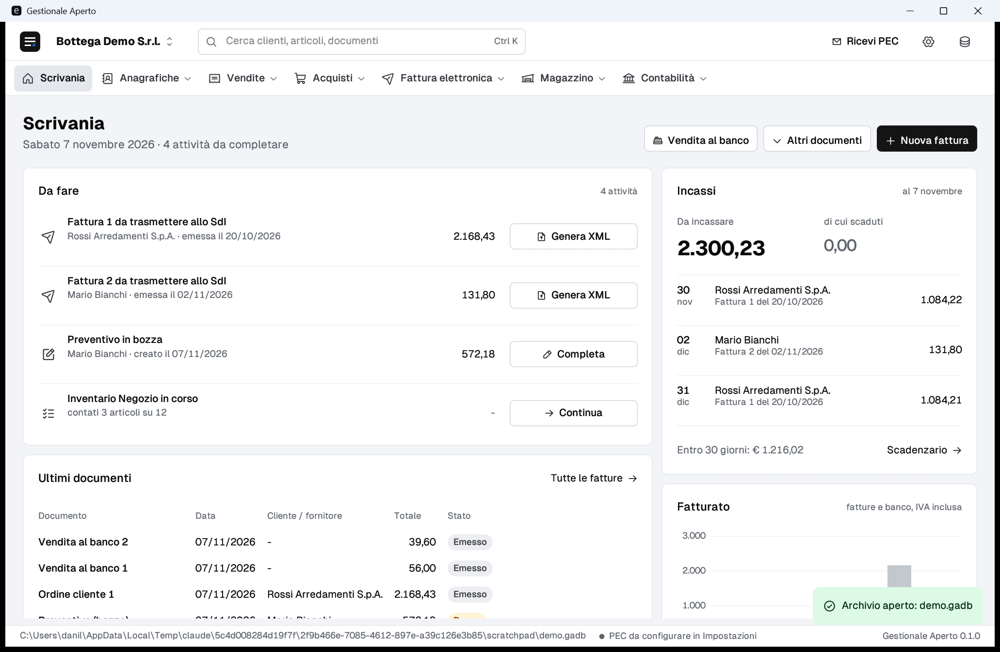

# openFatt

**Gestionale open source per la piccola impresa italiana**: anagrafiche, articoli e magazzino, documenti di vendita e acquisto, vendita al banco con registratore telematico, **fattura elettronica completa** (FatturaPA via PEC con lo SdI), scadenzario, banca, registri e liquidazione IVA, statistiche, agenti, più utenti in rete.

Scritto in Rust, applicazione desktop nativa per Windows. Licenza **AGPL-3.0-or-later**.

> Stato: versione 0.1, in sviluppo. Tutte le funzioni hanno test automatici e i file fiscali sono validati con gli schemi ufficiali, ma il programma **non è ancora stato usato in produzione** (vedi «Cosa non è ancora verificato»). Prima di usarlo per dati veri, provarlo su un archivio dimostrativo e tenere le copie di sicurezza.



## Funzioni

**Anagrafiche e articoli**
- Clienti e fornitori con controllo di P.IVA, codice fiscale, codice destinatario e IBAN; referenti; condizioni di pagamento, listino e sconti abituali; agente; dichiarazioni d'intento con plafond; carta fedeltà; allegati.
- Articoli e servizi: listini multipli, scaglioni, condizioni per cliente; varianti (taglia/colore) con codici a barre; lotti e scadenze; numeri di serie; foto e allegati; pezzi per confezione; contributo ambientale (RAEE, pile...); **gruppi di articoli** (kit) e **prodotti con distinta base**.
- Importazione di listini **Metel** (materiale elettrico), di articoli dalla **fattura elettronica del fornitore**, CSV ed Easyfatt-XML.
- Elenchi con colonne a scelta, ordinamento, raggruppamenti con subtotali, totali, selezione multipla, modifica di più schede insieme, esportazione in Excel.

**Vendite e acquisti**
- Preventivi, ordini, DDT, fatture immediate, accompagnatorie e differite, note di credito e debito, acconti, parcelle, proforma, autofatture TD16–TD29; ordini a fornitore, arrivi merce, fatture di acquisto.
- Trasformazioni ed evasioni parziali, numerazione per registro, serie e anno con controllo cronologico.
- Righe: subtotali, **righe calcolate** (percentuale delle righe precedenti), **calcolo inverso** (dal totale al prezzo, o sconto sul documento per arrivare a un totale), sconto merce, confezioni, gruppi che si espandono nei componenti, **ultimi prezzi praticati**, copia di righe da un altro documento, riordino.
- **Documenti ricorrenti** (canoni, abbonamenti) con il periodo nelle descrizioni.
- **Valuta estera** con cambio e controvalore in euro; agenti e provvigioni per documento, articolo o categoria.
- Allegati ai documenti, anche acquisiti con lo scanner.

**Fattura elettronica**
- FatturaPA 1.2.3 con oltre 40 controlli preventivi (codici di errore dello SdI), invio e ricezione via PEC, notifiche e stati, fatture passive (anche `.p7m`), PDF leggibile, firma digitale CAdES-BES con smart card, token o file `.pfx`.
- **Ordini NSO** della Pubblica Amministrazione (UBL): importazione e tripletta dell'ordine in fattura.
- Dichiarazione d'intento in fattura (`AltriDatiGestionali` INTENTO), bollo virtuale, ritenute, cassa previdenziale, scissione dei pagamenti.
- **Pacchetto per la conservazione** a norma (fatture, ricevute SdI, indice con impronte SHA-256) da consegnare al conservatore.

**Banco**
- Cassa con lettore di codici a barre, **tasti touch** per categoria, pagamenti misti, resi; documento commerciale emesso dal **registratore telematico** (adattatore nel formato INI pubblico, Epson XML in rete, comandi a modelli via file o HTTP, simulatore); corrispettivi giornalieri.
- **Carte fedeltà** a punti e **buoni regalo** (buoni multiuso).

**Magazzino**
- Più magazzini, trasferimenti, impegni e merce in arrivo, scorte minime, inventario fisico con Excel, **produzione** da distinta base, tracciabilità di lotti e seriali.

**Contabilità**
- Scadenzario con incassi parziali e **solleciti** a tre livelli, prima nota.
- Distinte **Ri.Ba.**, addebiti **SDD** e **bonifici** SEPA nei formati CBI per l'home banking.
- Registri IVA, **liquidazione** mensile o trimestrale e file della **Comunicazione LIPE**.
- **Prospetto per la dichiarazione IVA annuale** da dare al commercialista: quadri VE, VF, VJ, VL e VT (anche per regione) calcolati da registri e liquidazioni secondo le istruzioni ufficiali del modello IVA, in PDF ed Excel, con l'elenco delle voci da verificare a mano.
- **Operazioni di fine anno**: controlli, inventario valorizzato al 31/12, copia di sicurezza e blocco dell'anno.

**Analisi e organizzazione**
- **Statistiche** per cliente, articolo, categoria, agente, mese, fornitore con margini; confronto con l'anno precedente; **flussi di cassa** previsti a 12 mesi.
- **Agenti e provvigioni** sul fatturato o sull'incassato, insoluti, liquidazioni, estratto conto PDF/Excel.
- **Agenda** con appuntamenti, telefonate, attività e scadenze di pagamento.
- **Email** dei documenti in PDF e comunicazioni (SMTP, PEC o programma di posta).
- Stampe con tre modelli, logo e colore aziendale; etichette con codici a barre (A4 o rotolo).
- **Editor grafico dei modelli di stampa**: ogni elemento (dati dell'azienda e del cliente, numero, data, righe, totali, scadenze, testi fissi, logo, riquadri) si sposta e si ridimensiona col mouse, in millimetri; le righe continuano nelle pagine seguenti. **Moduli prestampati**: si carica la scansione del modulo come sfondo, si posizionano i campi sopra le caselle e si stampano solo i dati, con la correzione dell'allineamento della stampante.

**Passaggio da Easyfatt**
- **Importazione diretta dell'archivio** (file `.eft`): azienda, aliquote, pagamenti, agenti, clienti e fornitori, articoli con distinte base, tutti i documenti con righe, spese, cassa previdenziale e ritenute, scadenze con incassi e pagamenti, movimenti di magazzino e spese fuori campo IVA. Le fatture importate restano bloccate perché la fattura elettronica l'ha già trasmessa Easyfatt. Provata sui due archivi dimostrativi distribuiti con Easyfatt: tutti i documenti importati e tutti i totali ricalcolati uguali a quelli di Easyfatt, tranne gli acquisti in reverse charge (l'integrazione IVA va registrata a parte).
- L'archivio si legge **in sola lettura, da una copia**, con il motore Firebird già installato insieme a Easyfatt (a 32 bit), tramite il piccolo lettore `openfatt-easyfatt.exe`. Anche da riga di comando: `openfatt.exe --importa-easyfatt archivio.eft nuovo.gadb`.

**Più utenti e negozi online**
- Utenti con password e **permessi per area** (nessuno, lettura, modifica), registro delle operazioni firmato con l'utente, postazioni collegate, documento aperto altrove in sola lettura.
- **WooCommerce** e **Shopify**: scarico degli ordini come ordini cliente, pubblicazione di prezzi e giacenze.

## Dove sono i dati

| Cosa | Dove |
|---|---|
| Archivio di un'azienda | un unico file `.gadb` (database SQLite); i nuovi archivi vanno in `Documenti\openFatt`, ma si può aprire o creare un archivio in qualunque cartella, anche di rete |
| Copie di sicurezza automatiche | `Documenti\openFatt\Copie di sicurezza`: una al giorno alla chiusura del programma, si tengono le ultime 15 per archivio |
| Preferenze del programma (archivi recenti) | `%APPDATA%\openFatt\config.json` |
| Password di PEC, email e negozio online | Gestore credenziali di Windows, **mai** nell'archivio |
| Logo, foto degli articoli, allegati, fatture elettroniche e ricevute | dentro l'archivio `.gadb` |

La variabile d'ambiente `OPENFATT_DATA` sostituisce la cartella `Documenti\openFatt`. Per spostare un archivio basta copiare il file a programma chiuso. In *Impostazioni > Dati, utenti e postazioni* si vedono i percorsi in uso.

## Quanti dati regge

Prova di carico ripetibile (`cargo test --release -p openfatt-store --test carico -- --ignored --nocapture`) su un archivio con **100.000 articoli, 20.000 clienti e 30.000 fatture** da 5 righe:

| Operazione | Tempo misurato |
|---|---|
| Elenco completo degli articoli (100.000) | 0,20 s |
| Ricerca mentre si scrive (prime 60) | 0,05 s |
| Lettura di un codice a barre / ricerca per codice | meno di 1 ms |
| Giacenze di tutti gli articoli | 0,26 s |
| Ricerca clienti | 0,01 s |
| Elenco delle fatture (30.000) | 0,11 s |
| Ricerca di fatture per cliente | 0,17 s |
| Apertura di un documento | meno di 1 ms |
| Emissione di una nuova fattura | 0,08 s |
| Scadenzario aperto | 0,11 s |

Archivio risultante: 309 MB. Misure sul PC di sviluppo (Windows 11), compilazione release: su computer più lenti i tempi crescono in proporzione. Il programma si apre su questo archivio in circa un secondo e a riposo non consuma processore.

Gli elenchi a video si leggono una volta e restano in memoria finché l'archivio non cambia (anche da un'altra postazione); le ricerche mentre si scrive leggono al massimo 60 risultati. Il limite pratico è lo spazio su disco: SQLite gestisce file fino a diversi terabyte.

## Più postazioni in rete

Si mette l'archivio in una cartella condivisa (`\\server\dati` o un'unità di rete) e lo si apre da ogni computer. In rete il programma usa il registro classico di SQLite, compatibile con la condivisione di file, e scritture sincronizzate. Ogni salvataggio controlla la versione del record: nessuna sovrascrittura silenziosa. Chi apre un documento già aperto da un'altra postazione lo vede in sola lettura. Con molte postazioni contemporanee (oltre 5-6) conviene un server con disco veloce e una rete cablata.

## Compilazione e avvio

Serve Rust (stabile) per Windows.

```bash
cargo build --release
```

```bash
target/release/openfatt.exe
```

Il lettore degli archivi Easyfatt è a 32 bit come il motore Firebird di Easyfatt, e va messo accanto a `openfatt.exe`:

```bash
rustup target add i686-pc-windows-msvc
```

```bash
cargo build --release --target i686-pc-windows-msvc -p openfatt-fbread
```

Al primo avvio si crea un archivio vuoto oppure un **archivio dimostrativo** con dati di prova. Da riga di comando: `openfatt.exe --crea-demo prova.gadb`.

## Verifiche

- **165 test automatici** (`cargo test --workspace`), tra cui gli esempi numerici dell'Elenco controlli SdI, la rilettura degli esempi ufficiali FatturaPA e delle notifiche SdI, il percorso completo sull'archivio dimostrativo.
- **Collaudo completo** (`cargo test -p openfatt collaudo -- --nocapture`): percorre tutte le funzioni (righe speciali, valuta, dichiarazione d'intento, NSO, produzione, distinte bancarie, LIPE, agenti, statistiche, ricorrenti, carte, negozio online, utenti e blocchi, fine anno, conservazione, interscambio, copie di sicurezza) e salva i file prodotti in `target/collaudo` con un rapporto.
- I file prodotti sono **validi contro gli schemi ufficiali**: fatture elettroniche (`tools/valida-xsd.ps1`, schema VFPR12 1.2.3), bonifici e SDD CBI (`tools/valida-cbi.ps1`), Comunicazione LIPE (`tools/valida-lipe.ps1`).
- Codici a barre riletti con un decodificatore indipendente (ZXing); firme verificate con il validatore di .NET.
- Interfaccia controllata con catture dello schermo (`tools/screenshot.ps1`) e PDF controllati a vista.

### Cosa non è ancora verificato

- Invio reale allo SdI e lettura di una casella PEC reale; invio email reale.
- Firma con un certificato qualificato (le prove usano un certificato di test autofirmato, `crates/openfatt-sign/tests/data`).
- Registratori telematici reali: i driver Epson e a modelli vanno collaudati sul modello in uso.
- Caricamento delle distinte in un home banking reale, invio della LIPE all'Agenzia, ordini NSO reali da un intermediario PEPPOL, negozi WooCommerce/Shopify reali.
- Più postazioni su una vera cartella di rete (provato con due connessioni sullo stesso file).
- Importazione da Easyfatt su archivi reali diversi dai due dimostrativi e da versioni di Easyfatt con motore Firebird diverso dal 2.5.
- Stampa dei moduli prestampati su una stampante e un modulo reali (va regolata la correzione dell'allineamento).

## Struttura

```
crates/openfatt-core       modello dati, codici FatturaPA, controlli P.IVA/CF/IBAN, motore di calcolo, IVA
crates/openfatt-fatturapa  FatturaPA: costruzione, XML, lettura, controlli SdI, notifiche, .p7m
crates/openfatt-store      archivio SQLite: documenti, magazzino, scadenze, IVA, agenti, utenti, statistiche...
crates/openfatt-pec        PEC (SMTP/IMAP) ed email ordinaria
crates/openfatt-sign       firma digitale CAdES-BES (API di Windows)
crates/openfatt-bank       Ri.Ba. CBI, SDD e bonifici SEPA in XML CBI
crates/openfatt-pos        registratori telematici (INI, Epson XML, comandi a modelli, simulatore)
crates/openfatt-pdf        stampe PDF, etichette, codici a barre
crates/openfatt-interop    Easyfatt-XML, CSV, Excel, Metel, ordini NSO, WooCommerce/Shopify
crates/openfatt-fbread     lettura in sola lettura degli archivi Firebird (lettore openfatt-easyfatt, 32 bit)
app/                       applicazione desktop (egui)
specs/                     schemi XSD ufficiali ed esempi (vedi specs/README.md)
tools/                     validatori XSD e catture dello schermo
```

## Origine del progetto e limiti legali

openFatt è una **reimplementazione indipendente** («stanza pulita») delle funzioni tipiche di un gestionale commerciale italiano. Fonti usate:

| Fonte | Uso |
|---|---|
| Specifiche pubbliche dell'Agenzia delle Entrate (FatturaPA, SdI, LIPE) e del MEF (NSO) | formati, regole di calcolo e controlli |
| Standard CBI, SEPA, Metel, UBL/PEPPOL, API pubbliche WooCommerce e Shopify | file e collegamenti |
| Formato pubblico Easyfatt-XML | importazione ed esportazione (interoperabilità) |
| Interfaccia pubblica di Firebird e struttura dell'archivio letta dal catalogo del database | importazione dei propri dati da Easyfatt (interoperabilità, art. 64-quater L. 633/1941) |
| Modello e istruzioni ufficiali IVA 2026 dell'Agenzia delle Entrate | prospetto della dichiarazione annuale |
| Manuale pubblico e uso della versione di prova di un programma commerciale | solo l'elenco delle funzioni da offrire |

Non sono stati usati codice, codice decompilato, risorse grafiche, testi o marchi di software commerciali. I protocolli proprietari non pubblicati dei registratori non sono stati ricostruiti: il driver «a modelli» va configurato con il manuale del produttore.

*Danea*, *Easyfatt* e gli altri nomi citati sono marchi dei rispettivi titolari; sono nominati solo per indicare la compatibilità dei formati. openFatt non è collegato a Danea Soft né a TeamSystem.

## Componenti di terzi

- Carattere **Geist** (SIL Open Font License 1.1, `app/assets/fonts/OFL-Geist.txt`); icone **Phosphor** (MIT) tramite `egui-phosphor`.
- Il motore **Firebird** (licenza IPL/IDPL) non è incluso: il lettore usa quello installato con Easyfatt.
- Schemi XSD CBI come pubblicati nel progetto OCA/l10n-italy (AGPL-3.0); schemi ed esempi dell'Agenzia delle Entrate (documenti pubblici).
- Librerie Rust elencate nei `Cargo.toml`, con le rispettive licenze.

## Licenza

GNU Affero General Public License v3.0 o successiva (`LICENSE`). Chi distribuisce il programma modificato, anche come servizio in rete, deve renderne disponibile il codice sorgente.
